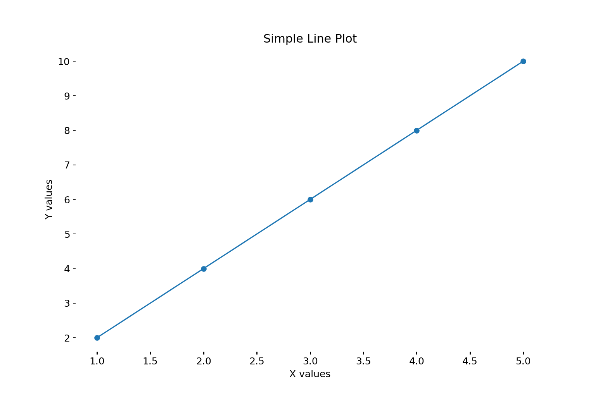

+++
title = "Hy: Python with Lisp Syntax"
description = "An introduction to Hy, the Lisp dialect that runs on Python."
authors = ["Giovanni Crisalfi"]
date = 2023-08-07
updated = 2026-11-03
draft = false

[taxonomies]
  tags = ["hy", "python", "lisp", "macros"]
  categories = ["programming"]
+++

Hy is a Lisp dialect that combines the expressive power of Lisp with the convenience and extensive libraries of Python.

<!-- more -->

It's cool because it doesn't transpile in Python, but converts the code directly into its abstract syntax tree (AST), so interoperability with libraries is guaranteed, and you don't have to deal with an intermediate layer of Python code.

I won't deliver a long theoretical speech about the beauty of Lisp on this occasion. If you're already familiar with Lisp dialects like Emacs Lisp, Common Lisp, Clojure, or Scheme, this is the place for you. If you've never heard of Lisp, this is a good place to start exploring its fundamentals by working with code firsthand.

## Plotting with Python-style code

### Installation

First of all, we need to install Hy.
Installing Hy is as simple as installing any library in Python.

```sh
pip install hy
```

The package provides a CLI tool for running Hy code by simply passing it the file name. Additionally, the package includes a terminal REPL that can be launched by entering `hy` in the shell, along with some other useful features. For comprehensive details, check `hy --help`.
It is also possible to install Hy in a virtual environment if you prefer not to directly touch the system. Assuming the reader is familiar with Python, I won't explain the process of creating and managing a virtual environment. Instead, we can proceed directly to the code.

### Importing a library

Imagine wanting to plot a simple series of points with Python.
There are many libraries to achieve this, but Matplotlib is probably the most famous and widely used. So, the first thing we would write in Python is:

```python
import matplotlib.pyplot as plt
```

Doing so, we would import the module `pyplot` from the library `matplotlib` and temporarily name it `plt` for brevity. In Hy, achieving the same result is straightforward: as in every other Lisp, each expression is enclosed in parentheses, with the first element acting as a function and the following elements as arguments. This simplicity makes the result quite intuitive.

```clojure
(import matplotlib.pyplot :as plt)
```

### Setting variables

Here, we set the point coordinates. We do this in two lists: one for the x-axis and the other for the y-axis. In Python, we would have written:

```python
x_values = [1, 2, 3, 4, 5]
y_values = [2, 4, 6, 8, 10]
```

In Hy:

```clojure
(setv x-values [1 2 3 4 5])
(setv y-values [2 4 6 8 10])
```

As you can see, the variables must be set with the `setv` (set variable) function.

### Unpacking values

Now we aim to assign fig and ax simultaneously, conventionally denoted as `fig` and `ax`, which are returned by a method of `plt` called `subplots()`. In Python words:

```python
# Create a figure and axis object
fig, ax = plt.subplots()
```

In other words, we have to master two operations: unpacking data from a function's return and executing a method.

Unpacking data is really simple, assign one list to another, ensuring equal values in both:

```clojure
(setv [a b] [1 2])
;; (print a) => 1
;; (print b) => 2
```

It works with tuples too:

```clojure
(setv [a b] (tuple [1 2]))
```

### Calling methods

Calling an object method is, also in this case, quite simple. You use the same (short) notation that distinguishes the call in Python: `plt.subplots()`. However, in this case, instead of placing parentheses after the term to clarify that we are invoking a function, we place them surrounding the function itself, like this: `(plt.subplots)`. This is the lispy way.
Putting things together:

```clojure
(setv [fig ax] (plt.subplots))
```

Now that the `ax` object has been created, we can call one of its methods to plot our values. This time, the method has arguments. In Python, we would write:

```python
# Plot the data as a line plot
ax.plot(x_values, y_values)
```

Remembering that in every Lisp, the initial term within the grouping of parentheses assumes the role of the function, succeeded thereafter by the arguments, the same principle extends to methods, which are — indeed — functions themselves:

```clojure
(ax.plot x-values y-values)
```

In this case, we may also want to specify a specific argument by name. We can do this by using a notation that should be familiar to us as it has already been seen in the `import` above.

```clojure
(ax.plot x-values y-values :marker "o")
```

We are about to reach the conclusion.

### Putting all together

All that remains is to recall other methods of `ax` to define the labels and the title.

```clojure
(ax.set-xlabel "X values")
(ax.set-ylabel "Y values")
(ax.set-title "Simple Line Plot")
```

Finally, let's gather all the code we have written and cap it with a `savefig` to admire our effort's fruit.

```clojure
(import matplotlib.pyplot :as plt)
(setv x-values [1 2 3 4 5])
(setv y-values [2 4 6 8 10])
(setv [fig ax] (plt.subplots))
(ax.plot x-values y-values :marker "o")
(ax.set-xlabel "X values")
(ax.set-ylabel "Y values")
(ax.set-title "Simple Line Plot")

(plt.savefig "img/hy-plt-example.png")
```



This first part was meant to be a gentle introduction for anyone, so I made sure to faithfully follow the style that would be adopted in Python. While switching to Hy may not immediately showcase its advantages, with patience, its benefits will become clear. In the next episode, we will code using a functional approach and then we will abstract the logic into a small macro. This will spare us from writing all the tedious boilerplate.

## Let blocks and macros

We briefly saw what Hy is, what it means that it is a dialect of Lisp, how to install it, and step by step, we wrote a small example to create a line plot in matplotlib, strictly following the imperative approach we would have used in Python.

```clojure
(import matplotlib.pyplot :as plt)
(setv x-values [1 2 3 4 5])
(setv y-values [2 4 6 8 10])
(setv [fig ax] (plt.subplots))
(ax.plot x-values y-values :marker "o")
(ax.set-xlabel "X values")
(ax.set-ylabel "Y values")
(ax.set-title "Simple Line Plot")

(plt.savefig "img/hy-plt-example.png")
```

If you don't understand something about the code above, I recommend referring to the first part: maybe something just went unnoticed until now.
If, instead, everything is clear, we can proceed. Now, it's time to make things more spicy by adopting a functional approach.

More precisely, we will begin by encapsulating everything in a `let`.

### What is a let?

Before rewriting our code, it is important to understand what a "let" is and why it is so useful.
If you are already familiar with this concept, feel free to skip this paragraph and proceed directly to the code.

A "let" is a Lisp operator that allows you to create a lexical context with new local variables. Basically, it's like saying you want to call a function that can access these variables and prioritize these variable declarations over other external ones with the same name.

How does it work?

> A let expression has two parts. First comes a list of instructions for creating variables, each of the form (variable expression). Each variable will initially be set to the value of the corresponding expression. [...]
> After the list of variables and values comes a body of expressions, which are evaluated in order.
> (Graham, ANSI Common Lisp, 1996, p. 20)

In Hy terms,

```clojure
(let [x 2]
  (print x))
```

The `x` variable defined in the head of the let is not accessible outside it.

Actually, the Hy let is pretty special, because it makes you write variables that have access to the ones defined previously in the same expression.
For example,

```clojure
(let [x 2
      y 3
      z (+ x y)]
  (print x)
  (print y)
  (print z))
```

As you can see here, the `z` variable is defined in relation to `x` and `y`.
[As the documentation explains](https://docs.hylang.org/en/stable/api.html),

> Like the let\* of many other Lisps, let executes the variable assignments one-by-one, in the order written

This means that, as `let*` in other lisps, `let` in Hy is functionally equivalent to a series of pure nested lets.

### Let('s) plot

Being conscious of how `let` works in Hy, we can now rewrite the initial code:

```clojure
(import matplotlib.pyplot :as plt)

(let [x-values [1 2 3 4 5]
      y-values [2 4 6 8 10]
      [fig ax] (plt.subplots)]

  (ax.plot x-values y-values :marker "o")
  (ax.set-xlabel "X values")
  (ax.set-ylabel "Y values")
  (ax.set-title "Simple Line Plot")
  (plt.savefig "img/hy-plt-example.png"))
```

Remember that let blocks can be nested. For example, in the case we want to plot two identical graphs but with different labels, we could write:

```clojure
(import matplotlib.pyplot :as plt)

(let [x-values [1 2 3 4 5]
      y-values [2 4 6 8 10]]

  ; English version
  (let [[fig ax] (plt.subplots)]
    (ax.plot x-values y-values :marker "x")
    (ax.set-xlabel "X values")
    (ax.set-ylabel "Y values")
    (ax.set-title "First Title")
    (plt.savefig "img/hy-plt-example-en.png"))

  ; Italian version
  (let [[fig ax] (plt.subplots)]
    (ax.plot x-values y-values :marker "o")
    (ax.set-xlabel "Ascisse")
    (ax.set-ylabel "Ordinate")
    (ax.set-title "Secondo titolo")
    (plt.savefig "img/hy-plt-example-it.png")))
```

This code saves two figures: an English one, and an Italian one.

### Macros

Lisp code, including Hy code, is expressed as a series of lists. Its minimalist syntax (or rather, the lack of it) allows for easy writing of macros.
But what is a macro?

> The most common way to write programs that write programs is by defining macros. Macros are operators that are implemented by transformation. You define a macro by saying how a call to it should be translated. This translation, called macro-expansion, is done automatically by the compiler. So the code generated by your macros becomes an integral part of your program, just as if you had typed it in yourself. (Graham, ANSI Common Lisp, 1996, p. 162)

In other words, macros are operators that write code and lisps are particularly good for metaprogramming, which means the code itself is treated as data that can be manipulated by itself, allowing for powerful generative techniques. This means also that we can build up our own language to make the code drier or more comfortable.

> Lisp is designed to be extensible: it lets you define new operators yourself. (Graham, ANSI Common Lisp, 1996, p. 3)

### Going meta

Let's see how we can leverage the power of macros in this case.
If you require a series of similar plots with only the title and filename being changed, you can write:

```clojure
(import matplotlib.pyplot :as plt)

(defmacro plot-with-title [title fname]
  (quasiquote (let [[fig ax] (plt.subplots)]
    (ax.plot x-values y-values :marker "o")
    (ax.set-xlabel "Ascisse")
    (ax.set-ylabel "Ordinate")
    (ax.set-title (unquote title))
    (plt.savefig (unquote fname)))))

(let [x-values [1 2 3 4 5]
      y-values [2 4 6 8 10]]

  (plot-with-title "First title" "img/hy-plt-example-one.png")
  (plot-with-title "Second title" "img/hy-plt-example-two.png"))
```

We can dream bigger by creating abstractions for all line plots.

```clojure
(import matplotlib.pyplot :as plt)

(defmacro lineplot [x y title fname marker xlabel ylabel]
  (quasiquote (let [x-values (unquote x)
                    y-values (unquote y)
                    [fig ax] (plt.subplots)]

                (ax.plot x-values y-values :marker (unquote marker))
                (ax.set-xlabel (unquote xlabel))
                (ax.set-ylabel (unquote ylabel))
                (ax.set-title (unquote title))
                (plt.savefig (unquote fname)))))

(lineplot [1 2 3 4 5]
          [2 4 6 8 10]
          "Titolo"
          "img/hy-plt-example-one.png"
          "o"
          "X values"
          "Y values")
```

As long as the macro definition is under your eyes, it's easy to understand the order in which to write the arguments. In this example: first the values for x and y, then the title, followed by the path of the image to be saved, the marker, and the labels. But this is just a simplified situation: usually, the macro definition is hidden in a library out of sight, so named arguments should be preferred over positional arguments.

Unfortunately, this is not directly possible in Hy because, [as described in the documentation](https://docs.hylang.org/en/stable/api.html),

> `defmacro` cannot use keyword arguments, because all values are passed to macros unevaluated. All arguments are passed positionally, but they can have default values:

```clojure
(defmacro a-macro [a [b 1]]
  `[~a ~b])

;; (a-macro 2)
;; [2 1]
;; (a-macro 2 3)
;; [2 3]
;; (a-macro :b 3)
;; [:b 3]
```

Thankfully, there's a nifty workaround to achieve both default values and positional arguments.
Instead of them being assigned in the macro, we write a simple wrapper function. Then we use the function for:

- Defining the default values;
- Giving names to the macro's positional arguments.

```clojure
(import matplotlib.pyplot :as plt)

(defmacro macro-lineplot [x
                          y
                          title
                          fname
                          marker
                          xlabel
                          ylabel]
  (quasiquote (let [x-values (unquote x)
                    y-values (unquote y)
                    [fig ax] (plt.subplots)]

                (ax.plot x-values y-values :marker (unquote marker))
                (ax.set-xlabel (unquote xlabel))
                (ax.set-ylabel (unquote ylabel))
                (ax.set-title (unquote title))
                (plt.savefig (unquote fname)))))

(defn lineplot [x
                y *
                [title "Title"]
                [fname "fname.png"]
                [marker "o"]
                [xlabel "X values"]
                [ylabel "Y values"]]
  (macro-lineplot x y title fname marker xlabel ylabel))
```

[The asterisk](https://docs.hylang.org/en/stable/api.html) (`*`) tells which parameters need the key:

> If the symbol \* is given in place of a parameter, it means that all the following parameters can only be set by name.

In other words, we have assigned default values that can be overridden by using the key's name.

Ultimately, assuming the macro is externalized in a library, the original code simplifies to these practical and fully functional lines:

```clojure
(lineplot [1 2 3 4 5]
          [2 4 6 8 10]
          :title "Simple Line Plot"
          :fname "img/hy-plt-example-last.png")
```

Of course, this is the simplest example I could think of, and there is room for a lot of improvement, but I think it makes the potential of the language and macros quite evident.
Moreover, keep in mind that the thrill lies in the fusion of these two powerful languages. By keeping the `hy` package as a dependency, Hy macros can be imported and used directly in Python code. This allows you to easily share the wrapper function with non-Hy users.

### Conclusion

In this post, we have discussed how to effectively use lexical scoped blocks and macros. Macros provide a powerful tool for metaprogramming, allowing you to extend the language and write code that is both cleaner and more expressive. By understanding and utilizing these features in Hy, you will be able to write more reliable code while still benefiting from Python libraries.
