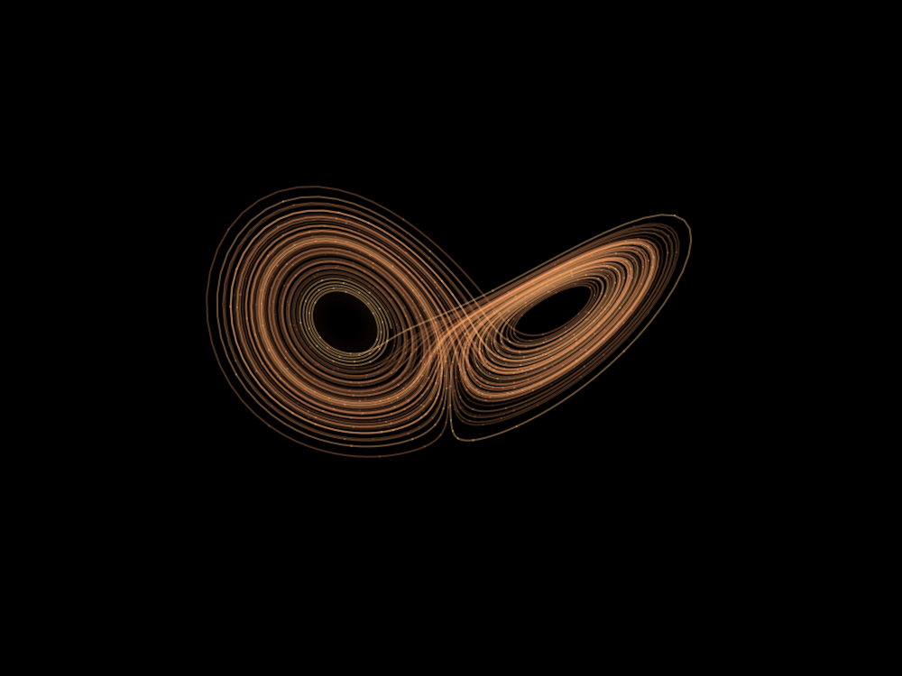

+++
title = "Literate plotting with Org-mode and Python"
description = "Using Org-babel as a reproducible notebook for equations, code, and figures."
authors = ["Giovanni Crisalfi"]
date = 2022-11-01
updated = 2026-11-03
draft = false

[taxonomies]
  tags = ["emacs", "org-mode", "python", "matplotlib", "data-viz"]
  categories = ["emacs", "science"]

[extra]
math = true
+++

Let's explore the shape of the Lorenz attractor with Python in Org mode/Emacs. Because why not.

<!-- more -->

## Intro

> The Lorenz system is a system of ordinary differential equations first studied by mathematician and meteorologist Edward Lorenz. It is notable for having chaotic solutions for certain parameter values and initial conditions. In particular, the Lorenz attractor is a set of chaotic solutions of the Lorenz system. In popular media the "butterfly effect" stems from the real-world implications of the Lorenz attractor, namely that in a chaotic physical system, in the absence of perfect knowledge of the initial conditions (even the minuscule disturbance of the air due to a butterfly flapping its wings), our ability to predict its future course will always fail. This underscores that physical systems can be completely deterministic and yet still be inherently unpredictable. The shape of the Lorenz attractor itself, when plotted in phase space, may also be seen to resemble a butterfly.&nbsp;[^fn:1]

## Python environment

As we had chosen Python, we need to import some python libraries:

- Numpy
- Scipy
- Matplotlib

We could install them globally with pip, but I prefer setting up a virtual environment. It's up to you; this script works both ways, but the second one requires a couple of additional steps. Basically, you have to:

- Create the new venv
- Install the packages inside the venv
- Access the venv from inside Emacs

I assume you know how to do the first two steps. About accessing the virtual environment from Emacs, I suggest the use of the `pyvenv` package. On vanilla Emacs you can install it with `use-package`. If you, like me, use a different distribution of Emacs, you will proceed with the installation in accord with that.

```sh
uv venv venv
uv pip install --python venv/bin/python numpy scipy matplotlib
```

Now, you should tell Emacs' pyvenv where our venv is. Let's say our venv is placed in `~/org-lorenz-attractor/venv`,

```elisp
(pyvenv-activate "~/org-lorenz-attractor/venv")
```

```sh
echo $VIRTUAL_ENV
which python
```

Check the version of matplotlib:

```python
import matplotlib
print(matplotlib.__version__)
```

I'm using `3.6.1` for this demo. You could try with other versions, but keep in mind that APIs may change.
Now you can import the libraries and go to the interesting part of this file.

```python
try:
    import numpy as np
    from scipy.integrate import solve_ivp
    import matplotlib.pyplot as plt
    from mpl_toolkits.mplot3d import Axes3D
    print("Success.")

except Exception as e:
    print(e)
```

## Math

The Lorenz system of coupled, ordinary, first-order differential equations has chaotic solutions for certain parameter values \(\sigma\), \(\rho\), \(\beta\) and initial conditions: \(u(0)\), \(v(0)\) and \(\omega (0)\).&nbsp;[^fn:2]

$$ \frac{du}{dt} = \sigma (v-u) $$

$$ \frac{dv}{dt} = \rho u - v - u \omega $$

$$ \frac{d \omega}{dt} = uv - \beta \omega $$

Translating the math into code, you should:

- Declare the parameters
- Write the equations as a function
- Integrate for the assigned parameters using `scipy`
- Interpolate the solution

```python
# Lorenz paramters and initial conditions.
sigma, beta, rho = 10, 2.667, 28
u0, v0, w0 = 0, 1, 1.05

# Maximum time point and total number of time points.
tmax, n = 100, 10000

def lorenz(t, X, sigma, beta, rho):
    """The Lorenz equations."""
    u, v, w = X
    up = -sigma*(u - v)
    vp = rho*u - v - u*w
    wp = -beta*w + u*v
    return up, vp, wp

# Integrate the Lorenz equations.
soln = solve_ivp(lorenz, (0, tmax), (u0, v0, w0), args=(sigma, beta, rho),
                 dense_output=True)

# Interpolate solution onto the time grid, t.
t = np.linspace(0, tmax, n)
x, y, z = soln.sol(t)
```

## Plot

Now, with the already imported matplotlib, we have to create the actual image of the Lorenz attractor.
Plot the points you gained from interpolation with Matplotlib.

> N.B. 'k' is just a single-character shorthand notation for the black color.
> Check [the docs](https://matplotlib.org/stable/tutorials/colors/colors.html) if you want to change the color.

```python
# We start with the constants that describe the image itself.
WIDTH, HEIGHT, DPI = 1000, 750, 100

# Plot the Lorenz attractor using a Matplotlib 3D projection.
try:
    fig = plt.figure(facecolor='k', figsize=(WIDTH/DPI, HEIGHT/DPI))
    ax = fig.add_subplot(projection='3d')
    ax.set_facecolor('k')
    fig.subplots_adjust(left=0, right=1, bottom=0, top=1)

    # Make the line multi-coloured by plotting it in segments of length s which
    # change in colour across the whole time series.
    s = 10

    # The 'winter' or 'cool' colormap are among the sequential ones.
    # I picked 'copper' this time, but you can select your favorite.
    # https://matplotlib.org/stable/tutorials/colors/colormaps.html
    cmap = plt.cm.copper

    for i in range(0,n-s,s):
        ax.plot(x[i:i+s+1], y[i:i+s+1], z[i:i+s+1], color=cmap(i/n), alpha=0.4)

    # Remove all the axis clutter, leaving just the curve.
    ax.set_axis_off()

    plt.savefig('lorenz.png', dpi=DPI)
    plt.show()
    print("Success.")

except Exception as e:
    print(e)
```



[^fn:1]: Source: [Wikipedia](https://en.wikipedia.org/wiki/Lorenz_system)
[^fn:2]: Source: [Scipython](https://scipython.com/blog/the-lorenz-attractor/)

---

## EDIT: 2026-11-03

The only update is in the code: the environment is now created and populated with `uv` to align the example with current Python tooling. The full Org source and generated figure are in the [org-lorenz-attractor repository](https://github.com/gicrisf/org-lorenz-attractor).
