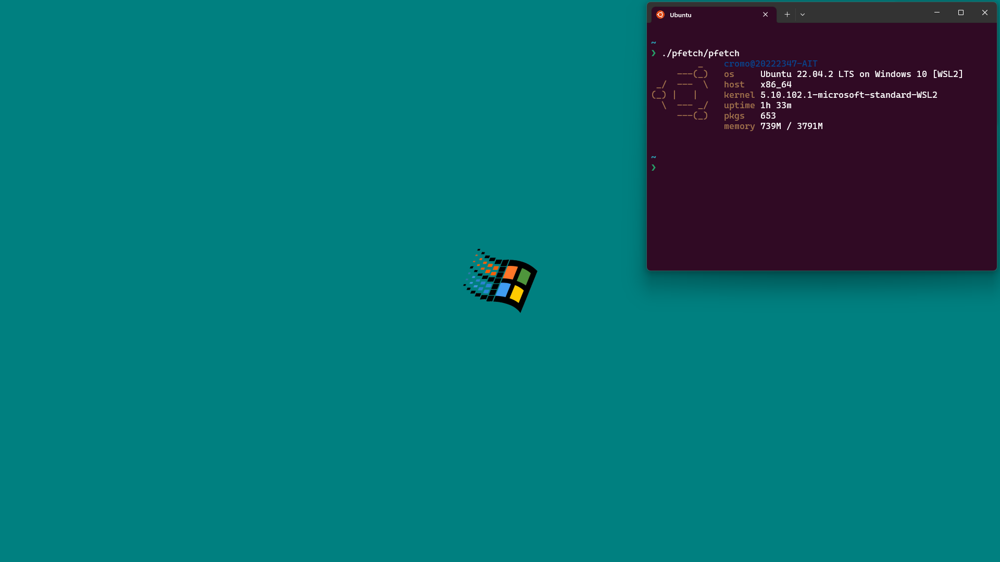

+++
title = "Navigating the perils and finding cozy shelters on a Windows Machine"
description = "What a company Windows laptop taught me about losing control of the desktop, and how Windmenu tries to take some of it back."
authors = ["Giovanni Crisalfi"]
date = 2023-05-27
draft = false

[taxonomies]
  tags = ["windows", "rust", "workflow"]
  categories = ["tools", "gui"]
  projects = ["windmenu"]
+++

In the end, the company PC has arrived. Company PC, in this case, means a Windows machine. Although it was a fresh installation, it seemed already plagued with problems: the bloatware and ads were overwhelming, so I disabled them. Windows Update failed, displaying a cryptic error code, and official Microsoft sites referred me to unofficial sites with ads, recommending obscure batch scripts of unknown functions.

<!-- more -->

I thought I could temporarily take refuge in WSL, but even WSL refused to work, despite multiple reinstalls. Even the energy-saving settings ignored my customizations! I wonder how something so new and so popular can be so broken. And I am exhausted already.

To tell the truth, I'm sorry it's like this. I spent my childhood on the old versions of Windows and it wasn't so broken. Yes, the system registry wasn't exactly transparent, but you still had the feeling that the machine was under your control. Now, instead, it seems that you have to take control by force. And yes, I'm sure you can do it, and the right batch scripts will do the magic, but how boring.

In the end, the unofficial script recommended by the official forum proved to be sufficient to solve the problem, resetting Windows Update, hence allowing me to update WSL, which finally decided to cooperate. The WSL terminal is as user-friendly as I remembered, or even more, and it even allows me to launch GUI applications without tinkering too much like it was in the past.

([Originally posted as a Mastodon thread.](https://fosstodon.org/@gicrisf/110428931293680966))
