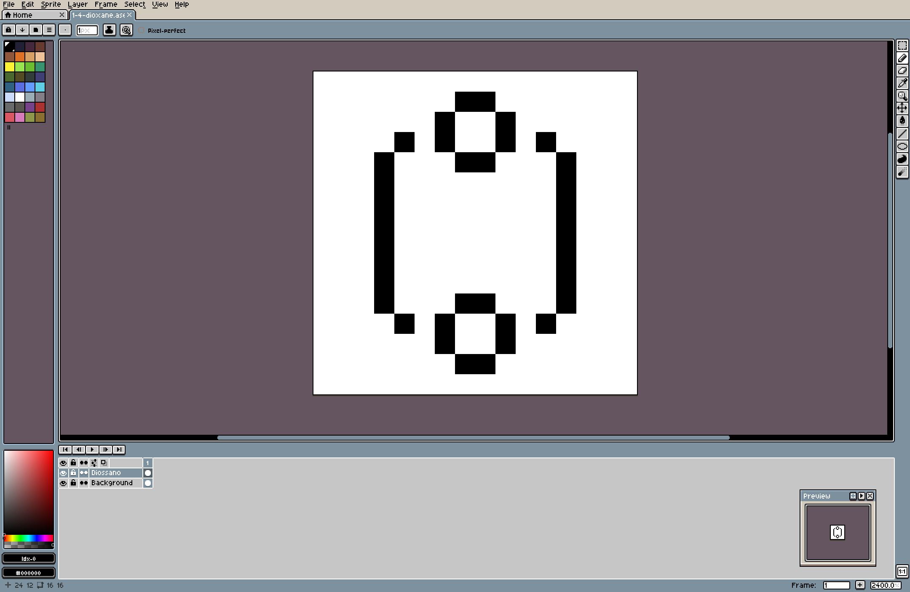
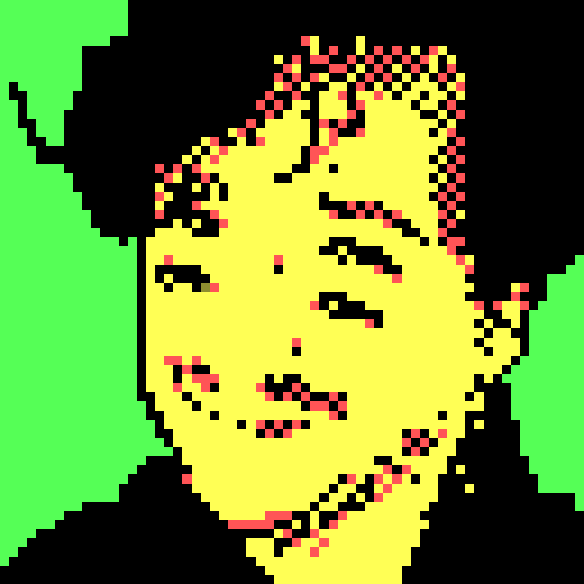

+++
title = "Scribbling pixels with Aseprite"
description = "A first attempt at pixel art."
authors = ["Giovanni Crisalfi"]
date = 2023-05-13

[taxonomies]
  tags = ["aseprite", "pixel-art", "workflow"]
  categories = ["design"]
+++

I have been fascinated by pixel art since I can remember.
For years, I've been having fun experimenting with pixel art programs, and I fell in love with dithering when I started messing with my blog generator code.
More generally, I have always loved visual art, but lacking what I thought were the necessary artistic skills for traditional painting methods, I never thought I could personally make it.
Yet, exposure to the works of talented people on the Fediverse made me wonder about scribbling in pixels.

What if I tried crafting pixels by hand too?
What could go wrong? (_Everything can go wrong, I have no time for doing this!_, says a side of my mind I choose to blatantly ignore).

<!-- more -->

I really love [GIMP](https://www.gimp.org/), but my past attempts with GIMP have never led me very far.
Maybe it was because it is more general-purpose, so, never having done pixel art _by hand_, I wouldn't know how to adapt the workspace to the needs of my pixels.

[Then Nico posted a screenshot of her desktop.](https://lia.fail/objects/fc45583d-2cbf-4db7-8e32-7c26a8305ab4)
While I was admiring her icon pack, I noticed this name: [Aseprite](https://www.aseprite.org/).
When I looked it up, I was blown away by the UI of this software: so vintage, so cool, I had to try it.
(I know, I know, I'm the type who gets hooked by a book cover.)

Here I want to leave my very first attempt at using Aseprite: a simple 16×16 binary image representing a molecule of 1,4-dioxane (basically the first thing I could think of).

Those are just some pixels scattered in a white field, but for my eyes, they hold a poetic charm.

Immediately after, I embarked on something more exciting: the faithful reproduction of my Mastodon profile picture into its corresponding pixel art; it represents a 4-eyed me through the lens of a [CGA0 4-color palette](https://lospec.com/palette-list/cga-palette-0-high).

Things escalated quickly and I tried pixelating everything: old logos, random images, pictures of hallways and so on.

For this burst of passion, I am grateful to the pixel artists of the Fediverse, and particularly Nico, who accidentally introduced me to this lovely software. Because of them, I now aspire to craft many more works.
