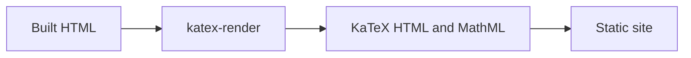

+++
template = "projects/page.html"
title = "KaTeX Render"
description = "Build-time KaTeX rendering for static HTML, without runtime JavaScript."
draft = false
weight = 67
page_template = "docs/page.html"
sort_by = "weight"
[extra]
  repo = "https://github.com/gicrisf/katex-render"
  language = ["Rust"]
+++

KaTeX Render is a post-build HTML transformer. It finds LaTeX in pages that opt into math, renders it with [katex-rs](https://github.com/katex-rs/katex-rs), and writes KaTeX HTML and MathML into the page. The KaTeX JavaScript runtime can then be removed from production output.

## Why {#why}

KaTeX normally typesets math in the browser. Static sites pay for that with an extra JavaScript download, parsing, and layout work on every math page. KaTeX Render moves the work to the build:

-   no KaTeX JavaScript in production output
-   no Node.js, browser, or WebAssembly runtime
-   HTML and MathML are present in the initial response
-   KaTeX CSS and fonts are still required for visual rendering

## Advantages {#advantages}

-   **Native:** One Rust binary built on `katex-rs`.
-   **Build-time:** Math is rendered once, not on every visit.
-   **Opt-in:** Only pages marked with a KaTeX stylesheet link are touched.
-   **Safe:** Code blocks, scripts, existing MathML, and existing KaTeX markup are skipped.
-   **Script-aware:** It can remove the KaTeX runtime script tags from processed pages.
-   **Focused:** It does not impose a Markdown parser or a template engine.

## Scope {#scope}

KaTeX Render works on built HTML. It does not parse Markdown, copy stylesheets or fonts, generate diagrams, or serve the site. It expects the KaTeX CSS and fonts to already be part of the site.

Rendering is opt-in. A page is processed only when it contains the configured marker, which defaults to `assets/katex/katex.min.css`.

This site uses KaTeX Render for the [Equations](/projects/ox-zola/content/equations/) documentation page.

## Current release {#current-release}

Version 0.1.0 targets Linux `x86_64` with a prebuilt musl binary. Building from source requires Rust 1.91 or newer.

## Credits {#credits}

KaTeX Render is built on [katex-rs](https://github.com/katex-rs/katex-rs), a Rust implementation of [KaTeX](https://katex.org/). It is independent and unofficial, and is not maintained by or affiliated with the KaTeX or katex-rs projects.

## License {#license}

MIT. See the [license](https://github.com/gicrisf/katex-render/blob/main/LICENSE). KaTeX CSS and fonts use their upstream licenses.
