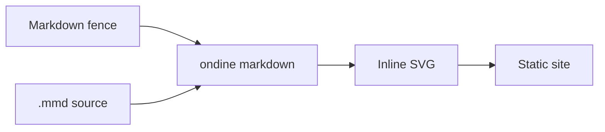

+++
title = "Ondine CLI"
description = "A native command-line front end for the Ondine Mermaid compiler."

template = "projects/page.html"
page_template = "docs/page.html"
sort_by = "weight"
weight = 40

[extra]
repo = "https://github.com/gicrisf/ondine-cli"
language = ["Rust"]
+++

Ondine CLI is the native command-line front end for the Ondine compiler. It renders Mermaid diagrams to SVG or ASCII, and transforms Mermaid fences in Markdown into inline SVG in a separate output tree. The package is `ondine-cli`; the installed binary is `ondine`.

## Why

The upstream Ondine toolchain runs through Node and npm. This front end keeps the same compiler and output but removes the Node startup and WebAssembly overhead: one native binary, no runtime, no network requests. It covers all 33 Ondine diagram types and fits into CI jobs, Makefiles, and static-site pipelines.

## Advantages

- **Native:** One Rust binary. No Node.js or WebAssembly runtime is needed.
- **Fast:** Avoids Node startup and WebAssembly compilation.
- **Identical output:** Uses the same Ondine compiler and produces the same SVG.
- **Complete:** All 33 Ondine diagram types.
- **Markdown-aware:** Transforms fenced Mermaid blocks without modifying the source files.
- **Build-friendly:** Fits CI jobs, Makefiles, and static-site pipelines.

## Performance

Native startup is a few milliseconds. The table compares ASCII output against `ondine@0.0.3`:

| Workload                       |     Rust |      npm | Ratio |
|--------------------------------|---------:|---------:|------:|
| 522 diagrams, per-type batches |  0.292 s |  9.041 s |   31x |
| 522 diagrams, one process      |  0.136 s |  0.959 s |    7x |
| Per diagram, one process       | 0.261 ms | 1.836 ms |    7x |

## Scope

This release renders SVG and ASCII, and transforms Markdown fences into a separate output tree. It does not edit Markdown in place, print terminal images, or produce JSON. `--check` verifies generated output. The compiler crate is pinned to a commit in `wevm/ondine` rather than a crates.io release, so compiler updates are deliberate.

Start with [Quick Start](@/projects/ondine-cli/getting-started/quick-start.md), then read [Markdown Fences](@/projects/ondine-cli/reference/markdown-fences.md) for the full transformation behavior.


Ondine is a Rust/WASM port of Pele for rendering #Mermaid graphs in a monochromatic fashion. When I discovered it, I immediately found it beautiful, but I didn't want to use #npm just to generate some SVGs.

So I wrapped their compiler and ported the #ASCII formatter into a pure #Rust CLI. No #Node or WASM at runtime, so it is also smaller and faster: ideal for a quick #cargo or #Nix install.

If you need quick #diagrams, enjoy. Thanks to the Pele and Ondine folks.

[github.com/gicrisf/ondine-cli](https://github.com/gicrisf/ondine-cli)


## Credits

This project exists because of [Ondine](https://ondine.sh), which ports [Pele](https://github.com/obsidianmd/pele). It is independent and unofficial, and is not maintained by or affiliated with the Ondine project.

## License

MIT. See the [license](https://github.com/gicrisf/ondine-cli/blob/main/LICENSE).
