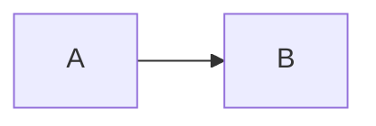

+++
title = "Markdown Fences"
description = "Transform fenced Mermaid blocks into inline SVG without editing the source."
weight = 10

[extra]
lead = "The Markdown transformer replaces Mermaid fences in an output tree, leaving the source files untouched."
toc = true
+++

## What gets transformed

A fenced code block tagged `mermaid` is replaced with inline SVG:

````markdown

````

The generated Markdown contains:

```html
<div class="mermaid-diagram">
  <svg ...>...</svg>
</div>
```

The transformer handles backtick and tilde fences, indented fences, and multiple diagrams in one file. Fences in other languages are left untouched. An unclosed fence is also left unchanged.

## Source files stay untouched

Use `--out-dir` to write the transformed Markdown into a separate tree:

```sh
ondine markdown content --out-dir build/content
```

Directory inputs mirror their relative paths under the output directory. For example, `content/posts/example.md` becomes `build/content/posts/example.md`.

The command writes Markdown only. Copy non-Markdown files from the source tree separately if your site needs colocated assets.

## Check generated output

```sh
ondine markdown content --out-dir build/content --check
```

`--check` writes nothing. It exits with status 1 when a generated file is missing or stale, which makes it suitable for CI. The output directory must already exist.

## Write one file to stdout

```sh
ondine markdown page.md --stdout
```

`--stdout` accepts exactly one Markdown file and writes the transformed Markdown to standard output.

## IDs and accessibility

Ondine emits fixed `ondine-title` and `ondine-desc` IDs when the diagram source defines an accessibility title or description. The transformer namespaces those IDs per diagram, so multiple diagrams can share one page without collisions.

Use Mermaid's `accTitle` and `accDescr` directives in the fence:

````markdown

````

There is no separate alt or caption metadata syntax. The fence source and the generated SVG carry the accessible information.

## Static site example

A typical static-site pipeline is:

```sh
ondine markdown content --out-dir build/content
```

Build the site from `build/content`, or use the same directory as the content root of your generator. Keep the original `content` tree as the source of truth.
