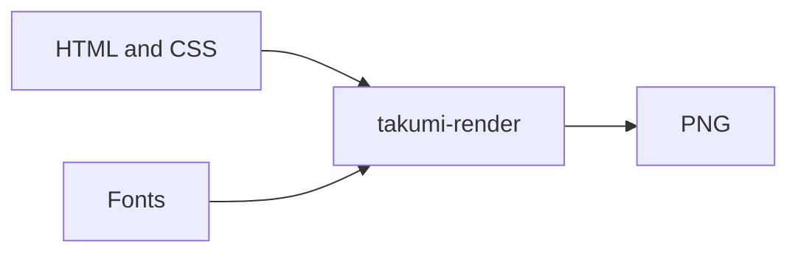

+++
template = "projects/page.html"
title = "Takumi Render"
description = "Native HTML/CSS to PNG rendering with Takumi, without Node.js."
draft = false
weight = 65
page_template = "docs/page.html"
sort_by = "weight"
[extra]
  repo = "https://github.com/gicrisf/takumi-render"
  language = ["Rust"]
+++

Takumi Render is a native command-line front end for [Takumi](https://github.com/kane50613/takumi)'s Rust renderer. It reads HTML and CSS, registers the fonts you provide, and writes PNG files. It needs no Node.js, npm, or WebAssembly runtime.

## Why {#why}

Takumi publishes a Rust engine and npm bindings, but no general-purpose PNG command-line tool. Takumi Render fills that gap for static-site builds, social-preview generation, and any workflow that already produces HTML and CSS.

## Advantages {#advantages}

-   **Native:** One Rust binary. No Node.js, npm, or WebAssembly at runtime.
-   **Focused:** It renders HTML to PNG and does not impose a template engine.
-   **Batch-friendly:** A manifest loads fonts once and renders many cards in order.
-   **Offline:** It makes no network requests.
-   **Predictable:** Width, height, fonts, inputs, and outputs are explicit.

## Scope {#scope}

This release renders one PNG per HTML input. It does not fetch remote images, generate social metadata, or know anything about a particular static site. Use data URLs for local images and keep the card layout in the calling project.

Start with [Quick Start](/projects/takumi-render/getting-started/quick-start/), then use [Batch Manifests](/projects/takumi-render/reference/batch-manifests/) for multi-card builds.

## Current release {#current-release}

Version 0.1.0 targets Linux `x86_64` with a prebuilt musl binary. Building from source requires Rust 1.91 or newer.

## Credits {#credits}

This project exists because of [Takumi](https://github.com/kane50613/takumi). It is independent and unofficial, and is not maintained by or affiliated with the Takumi project.

## License {#license}

MIT. See the [license](https://github.com/gicrisf/takumi-render/blob/main/LICENSE).
